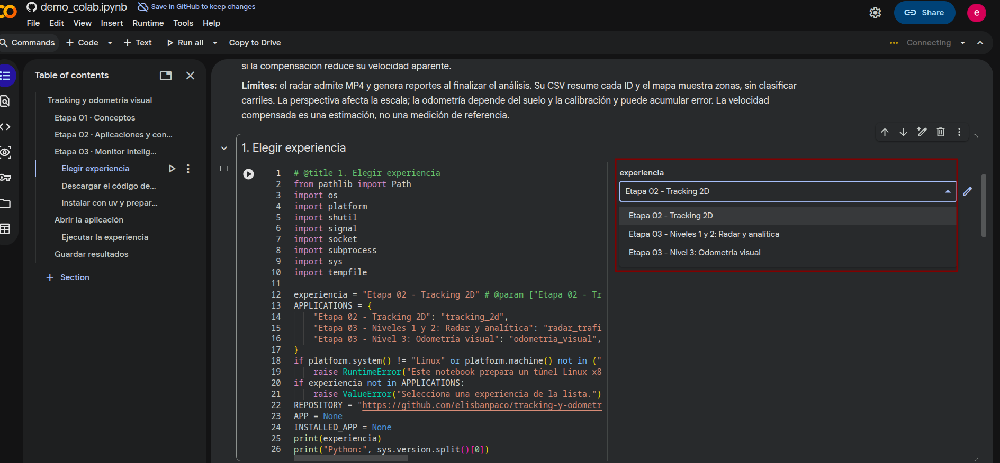
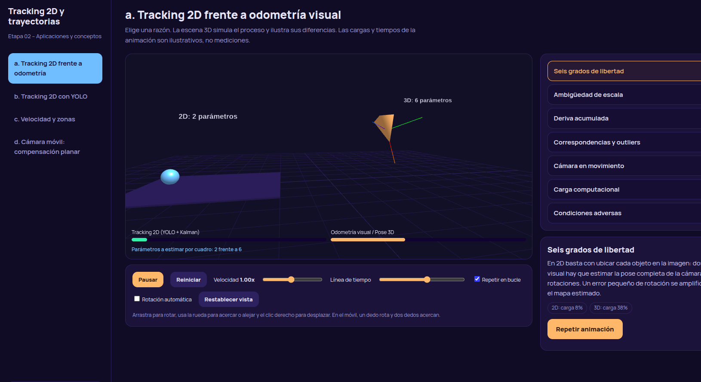
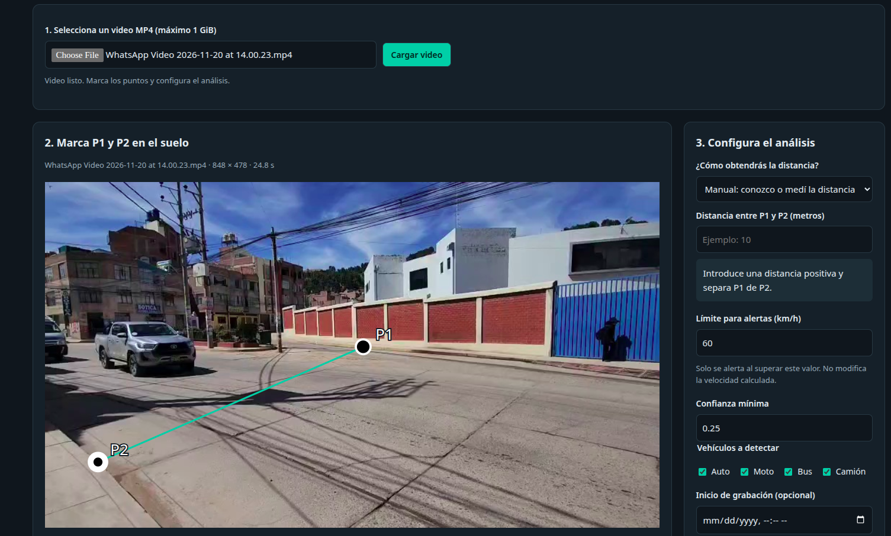
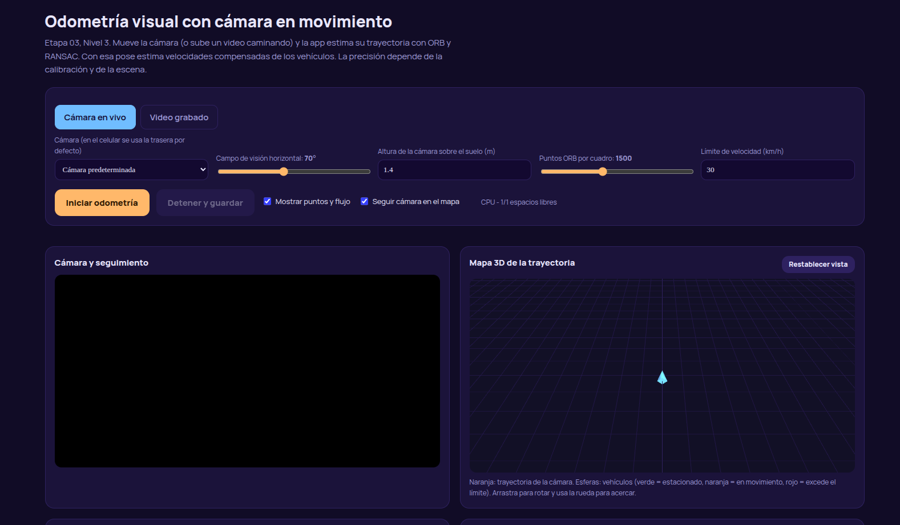

# Tracking y odometría visual

Tres aplicaciones para comprender la diferencia entre seguir objetos y estimar el movimiento de una cámara, y cómo se complementan en el análisis de tráfico.

El **tracking** mantiene IDs y trayectorias de objetos entre imágenes. La **odometría visual** estima el movimiento de la cámara. Al combinarlos, se puede compensar parte del movimiento aparente causado por la cámara.

## Empezar en Colab

**Ingresa aquí para ejecutar el proyecto:**

[https://colab.research.google.com/github/elisbanpaco/tracking-y-odometria-visual/blob/main/demo_colab.ipynb](https://colab.research.google.com/github/elisbanpaco/tracking-y-odometria-visual/blob/main/demo_colab.ipynb)

[Ver el notebook en el repositorio](demo_colab.ipynb)

1. Selecciona GPU si está disponible; también puedes usar CPU, con menor rendimiento.
2. Elige una experiencia y ejecuta las celdas en orden.
3. Abre el **LINK PÚBLICO** que aparece en la salida.
4. Descarga los resultados antes de detener la ejecución.

**Elige una aplicación en el selector. Cada ejecución abre únicamente esa aplicación.**



El notebook descarga `apps/` desde la rama `main`, instala los requisitos con `uv` y muestra el commit utilizado. Los cambios locales estarán disponibles al publicarlos en GitHub y repetir la descarga. Una copia del notebook guardada en Drive no se actualiza automáticamente.

Para cambiar de aplicación, detén la ejecución anterior, cambia la selección y repite las celdas. Las tres usan el puerto 8000; el notebook carga una instancia de YOLO a la vez.

## Aplicaciones y actividad

| Aplicación | Parte del enunciado | Funciones |
| --- | --- | --- |
| [Tracking 2D](apps/tracking_2d/README.md) | Etapa 02, apartados a–d | Comparación conceptual, YOLO con ByteTrack/BoT-SORT, conteo, trayectorias, velocidad, zonas y compensación planar |
| [Radar de tráfico](apps/radar_trafico/README.md) | Etapa 03, niveles 1 y 2 | Calibración, km/h, alertas, CSV, mapa de calor y gráfica temporal |
| [Odometría visual](apps/odometria_visual/README.md) | Etapa 03, nivel 3 | Pose y trayectoria estimadas de la cámara; velocidades aparentes y compensadas |

<details>
<summary>Ver Tracking 2D · Etapa 02</summary>



Interfaz con los apartados a–d: comparación, seguimiento, velocidad y compensación planar.

[Ver instrucciones de Tracking 2D](apps/tracking_2d/README.md)

</details>

<details>
<summary>Ver Radar de tráfico · Etapa 03, niveles 1 y 2</summary>



Marca dos puntos e introduce su distancia real para calibrar la estimación de velocidad.

[Ver instrucciones del radar](apps/radar_trafico/README.md)

</details>

<details>
<summary>Ver Odometría visual · Etapa 03, nivel 3</summary>



Selecciona cámara o video y configura los parámetros para estimar el movimiento.

[Ver instrucciones de odometría visual](apps/odometria_visual/README.md)

</details>

La **etapa 01** es conceptual: pasos y tipos de odometría, comparación con ruedas, relación con VIO y SLAM, aplicaciones y diferencias frente al tracking, incluidos RA y VFX. Las respuestas teóricas y el informe final no están incluidos.

Cada carpeta contiene `app.py`, `requirements.txt` y una guía de uso. El servidor y la interfaz permanecen en un archivo por aplicación.

## Ejecutar una aplicación directamente

Con el repositorio cargado en Colab, ejecuta desde su raíz. Ejemplo para el radar:

```python
!pip -q install uv
!uv pip install --system -r apps/radar_trafico/requirements.txt
!python apps/radar_trafico/app.py
```

`--system` instala en el entorno de Colab. También puedes usar `!pip -q install -r apps/radar_trafico/requirements.txt`. Las guías individuales incluyen sus comandos y requisitos externos.

Se necesita Internet para descargar dependencias, modelos YOLO, recursos de la interfaz y el túnel `cloudflared` para Linux x86_64. Quien conozca el enlace público puede acceder a la aplicación. Permite la cámara en el navegador si usas webcam y descarga los resultados: los archivos del entorno son temporales.

## Alcance y límites

- Tracking trabaja en píxeles y permite una conversión métrica local. Su compensación de cámara móvil usa un plano; no es odometría 3D.
- Radar recibe MP4 de cámara fija. Genera los reportes al finalizar el análisis; su CSV resume cada ID y el mapa no clasifica carriles automáticamente.
- Odometría estima escala usando altura de cámara y suelo plano. Puede perder seguimiento y acumular deriva.
- Las velocidades son estimaciones académicas. La perspectiva, la calibración y los cambios de ID afectan las mediciones y conteos.

Las comprobaciones de cálculos y la exportación de video con detecciones simuladas pasaron. La validación completa con YOLO, webcam y GPU en Colab sigue pendiente; las dependencias no están fijadas completamente por versión.

## Contribuir

Al reportar un problema, indica aplicación, entorno, pasos y mensaje de error. Para proponer una mejora, explica qué comportamiento cambia y cómo lo comprobaste. Comparte solo videos y resultados que tengas permiso para publicar.
