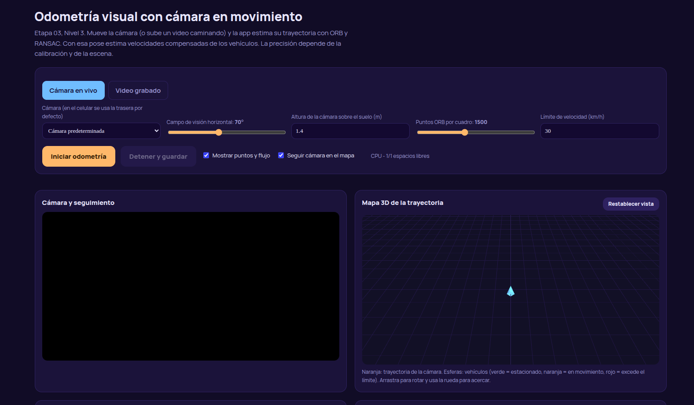

# Odometría visual

[Volver al proyecto](../../README.md)

Aplicación de la **etapa 03, nivel 3**. Estima el movimiento de una cámara monocular y compara velocidades aparentes y compensadas de los objetos seguidos.



## Ejecutar

En el [notebook](../../demo_colab.ipynb), selecciona **Etapa 03 - Nivel 3: Odometría visual**. O ejecuta desde la raíz del repositorio en Colab:

```python
!pip -q install uv
!uv pip install --system -r apps/odometria_visual/requirements.txt
!NPOOL=1 python apps/odometria_visual/app.py
```

Abre el **LINK PÚBLICO** de la salida. El arranque del túnel utiliza `wget`. Consulta la [guía de inicio](../../README.md#empezar-en-colab) para preparar el entorno y cambiar de aplicación.

## Usar y comparar

1. Elige webcam móvil o un video grabado caminando, con suelo y textura visibles.
2. Ajusta altura de cámara, campo de visión, número de características y límite de velocidad.
3. Inicia y observa la trayectoria estimada, las gráficas y el estado del seguimiento.
4. Compara velocidades aparentes y compensadas de un vehículo estacionado.
5. Pulsa «Detener y guardar» y descarga los CSV antes de interrumpir Colab.

Para la comparación del enunciado, procesa primero el mismo video móvil en el [radar](../radar_trafico/README.md). Registra si la compensación reduce el movimiento aparente del vehículo estacionado.

## Cómo funciona

YOLO y ByteTrack siguen personas y vehículos; sus cajas con ID se excluyen de la búsqueda de puntos del fondo. ORB combina FAST orientado y BRIEF rotado; sus correspondencias, RANSAC y la matriz esencial permiten estimar rotación y dirección de traslación.

La escala se estima con una homografía, altura de cámara y supuesto de suelo plano. Las poses se acumulan para dibujar la trayectoria y compensar posiciones y velocidades.

## Resultados

| Archivo | Contenido |
| --- | --- |
| `trayectoria_camara.csv` | Tiempo, posición estimada, rumbo, velocidad, correspondencias aceptadas y estado |
| `vehiculos.csv` | Tiempo, ID, clase, posición y velocidades aparente y compensada; puede incluir personas |

Los registros permanecen en el navegador hasta descargarlos. No se exporta video anotado. El campo `v_real_kmh` conserva su nombre por compatibilidad y significa **velocidad compensada estimada**.

## Límites y configuración

La mitad inferior de la imagen puede contener paredes u otros planos y producir una escala incorrecta. Altura y campo de visión afectan las medidas; poca textura, desenfoque y oclusiones pueden interrumpirlas. La trayectoria acumula error. No se garantiza velocidad cero en objetos estacionados ni precisión métrica.

| Variable | Valor predeterminado | Uso |
| --- | --- | --- |
| `WEIGHTS` | `yolo11m.pt` | Modelo YOLO |
| `NPOOL` | `3` | Instancias del modelo; el comando anterior usa una |

Modelo y túnel se descargan en el directorio de ejecución. Esta aplicación no utiliza `JOBS_DIR`.
