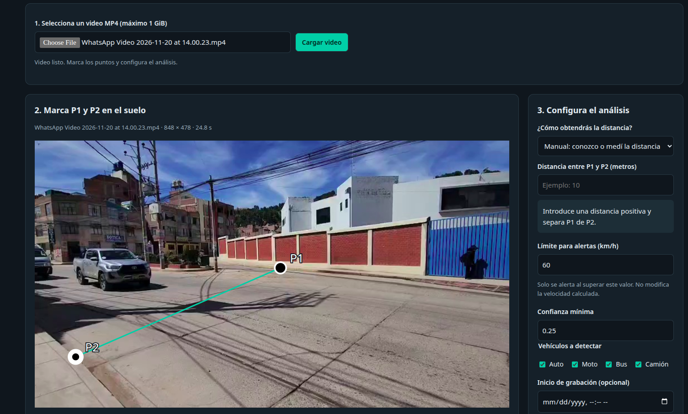

# Radar de tráfico

[Volver al proyecto](../../README.md)

Aplicación de la **etapa 03, niveles 1 y 2**. Usa YOLO11n y ByteTrack para estimar velocidades de vehículos, mostrar alertas y generar analítica con una cámara fija.



## Ejecutar

En el [notebook](../../demo_colab.ipynb), selecciona **Etapa 03 - Niveles 1 y 2: Radar y analítica**. O ejecuta desde la raíz del repositorio en Colab:

```python
!pip -q install uv
!uv pip install --system -r apps/radar_trafico/requirements.txt
!python apps/radar_trafico/app.py
```

Abre el **LINK PÚBLICO** de la salida. La [guía de inicio](../../README.md#empezar-en-colab) explica cómo preparar el entorno y cambiar de aplicación.

## Nivel 1 · Calibrar y medir

1. Carga un MP4 de cámara fija, de hasta **1 GiB**. Si usas webcam, graba primero el video.
2. Selecciona un fotograma y marca P1/P2 sobre el suelo, cerca del paso de los vehículos.
3. Introduce la distancia real en metros. Puedes medirla en Google Maps y copiarla manualmente.
4. Configura límite, confianza y clases: autos, motos, buses o camiones.
5. Inicia el análisis y observa velocidades y alertas.

```text
píxeles por metro = distancia en píxeles / distancia real en metros
km/h = velocidad en px/s / píxeles por metro × 3,6
```

La medición sigue el punto inferior central de la caja durante una ventana de 0,5 segundos. La alerta se activa al superar el límite configurado.

## Nivel 2 · Analizar y descargar

Si conoces la fecha y hora inicial de grabación, indícala antes de analizar para obtener conteos por hora. Sin ella, la gráfica usa segundos o minutos del video. Los reportes se generan al finalizar el análisis, antes de cerrar el programa.

| Archivo | Contenido |
| --- | --- |
| `output.mp4` | Video con IDs, velocidades y alertas |
| `vehicles.csv` | Resumen por ID: apariciones, observaciones, velocidad máxima y exceso |
| `heatmap.png` | Zonas utilizadas; cada ID aporta una visita por celda |
| `traffic-by-time.png` | Nuevos IDs de automóviles por intervalo |

Descarga los archivos antes de cerrar Colab. El CSV resume vehículos seguidos; para coordenadas por fotograma utiliza [tracking 2D](../tracking_2d/README.md).

## Límites y configuración

La escala cambia con la perspectiva: calibra cerca del área de medición. La aplicación no compensa movimiento de cámara ni identifica carriles automáticamente. Los cambios de ID afectan el conteo. Las velocidades son estimaciones académicas, sin validez para sanciones.

`JOBS_DIR` define dónde guardar trabajos, modelo y túnel; por defecto es `/content/traffic-monitor`. El video se procesa con PyAV. Esta aplicación no utiliza `WEIGHTS` ni `NPOOL`.

Comprobación de escala, interpolación, pérdida de seguimiento y límite, sin dependencias externas:

```bash
python apps/radar_trafico/app.py --check
```
