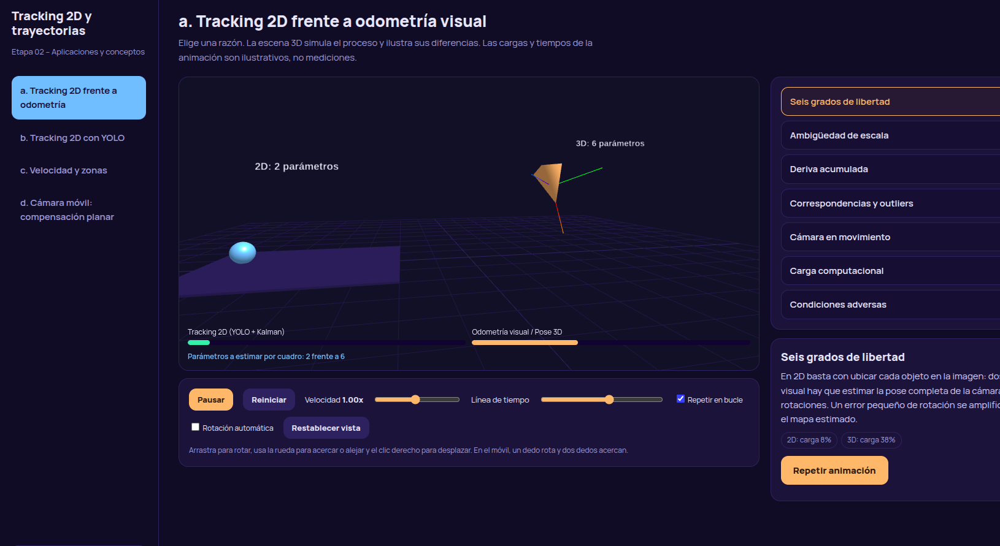

# Tracking 2D

[Volver al proyecto](../../README.md)

Aplicación de la **etapa 02, apartados a–d**. Detecta objetos con YOLO, mantiene IDs con ByteTrack o BoT-SORT y analiza sus trayectorias.



## Ejecutar

En el [notebook](../../demo_colab.ipynb), selecciona **Etapa 02 - Tracking 2D**. También puedes ejecutar desde la raíz del repositorio en Colab:

```python
!pip -q install uv
!uv pip install --system -r apps/tracking_2d/requirements.txt
!NPOOL=1 python apps/tracking_2d/app.py
```

Abre el **LINK PÚBLICO** de la salida. Para videos necesitas FFmpeg; comprueba `!ffmpeg -version`. Si falta, ejecuta `!apt-get -qq update` y `!apt-get -qq install -y ffmpeg`. El arranque del túnel utiliza `wget`. Consulta la [guía de inicio](../../README.md#empezar-en-colab) para preparar el entorno y cambiar de aplicación.

## Usar las cuatro secciones

| Apartado | Pasos |
| --- | --- |
| a · Comparación | Explora las animaciones de tracking 2D frente a odometría. Las cargas y tiempos son ilustrativos. |
| b · Tracking | Elige video o webcam fija, tracker y clases. Coloca la línea e inicia el análisis para observar IDs, cruces y trayectorias. |
| c · Velocidad y zonas | Consulta px/s, cuadrícula 3 × 3 y mapa de calor. Puedes alternar entre b y c conservando el análisis. |
| d · Cámara móvil | Abre la cámara ante un fondo plano con textura. Cuando aparezca «Fondo listo», captura la referencia y mueve suavemente la cámara. Compara amarillo (original) y verde (compensado). |

Para estimar **m/s** en c, pulsa «Marcar referencia», marca dos extremos, escribe su distancia real y aplica. En video, calibra antes del análisis. Al cambiar de archivo o reiniciar la cámara, marca otra referencia.

Para guardar webcam o compensación planar, utiliza el botón de detener y guardar de su sección antes de interrumpir Colab.

## Resultados

| Modo | Archivos descargables |
| --- | --- |
| Video | `video.mp4`, `mapa_calor.png`, `trayectorias.csv`, `resultados.json` |
| Webcam fija | `trayectorias_en_vivo.csv` |
| Cámara móvil planar | `comparacion_planar.csv` |

Los CSV de tracking incluyen ID, clase, frame, tiempo, centro, velocidad y zona; con calibración, también escala y m/s aproximados. El CSV planar registra segmentos de referencia y validez de la compensación. Los datos capturados en vivo permanecen en el navegador hasta descargarlos.

## Interpretar las medidas

La velocidad compara posiciones consecutivas de cada ID. El mapa acumula detecciones, no objetos únicos ni segundos de permanencia. El contador admite una entrada y una salida por ID; las oclusiones pueden cambiar los IDs.

La escala métrica es local: referencia y objetos deben tener profundidad similar. En d, ORB y una homografía compensan movimiento sobre un plano en píxeles de referencia. Si se pierde el seguimiento, se suspenden las medidas compensadas. No estima pose 3D ni metros; esa experiencia corresponde a [odometría visual](../odometria_visual/README.md).

## Configuración y comprobaciones

| Variable | Valor predeterminado | Uso |
| --- | --- | --- |
| `JOBS_DIR` | `/content/jobs` | Trabajos de video |
| `WEIGHTS` | `yolo11l.pt` | Modelo YOLO |
| `NPOOL` | `6` | Instancias del modelo; el comando anterior usa una |

Dedica `JOBS_DIR` solo a resultados: al subir un video se eliminan carpetas de trabajos de más de dos horas. Modelos y túnel se descargan en el directorio de ejecución.

```bash
python apps/tracking_2d/app.py --autoprueba
python apps/tracking_2d/app.py --autoprueba-planar
JOBS_DIR=/tmp/prueba-video python apps/tracking_2d/app.py --autoprueba-video
```

Comprueban cálculos, compensación sintética y exportaciones. Las dos últimas requieren sus dependencias; la de video usa FFmpeg y detecciones simuladas, sin validar YOLO real.
